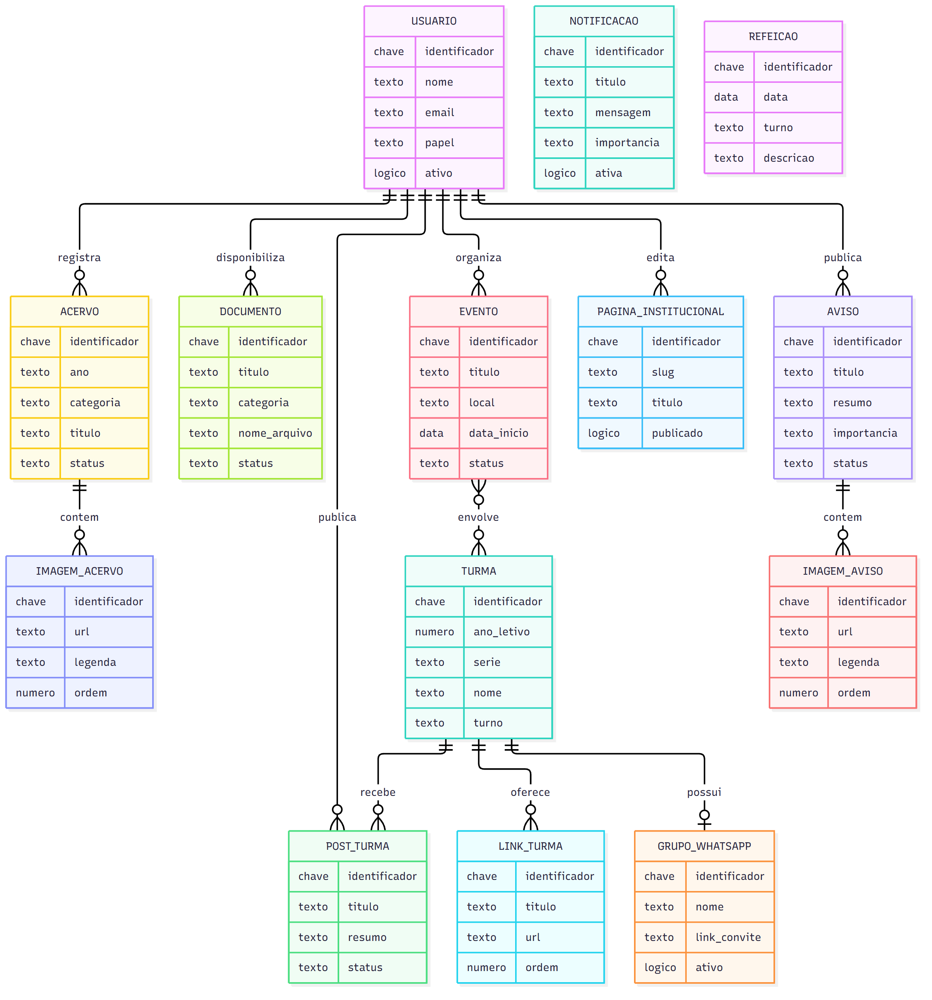
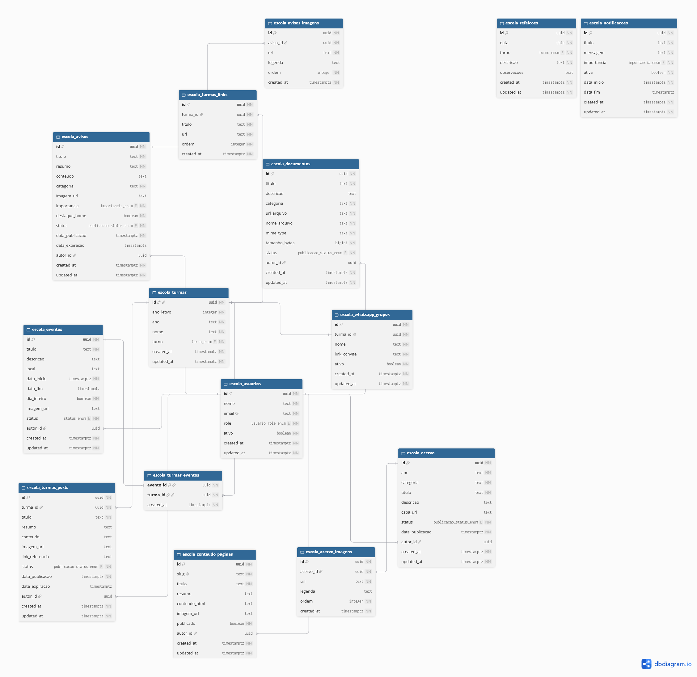

# Portal Escolar EEB Prof. Benonívio João Martins — Modelagem e Refatoração Relacional (A3)

O Portal Escolar da Escola de Educação Básica Professor Benonívio João Martins (Palhoça/SC) é uma aplicação real em produção (`escolabenonivio.vercel.app`) desenvolvida com Next.js, PostgreSQL 17 e Supabase. Na primeira versão do sistema, o banco foi estruturado com 9 tabelas, uso intensivo de colunas `JSONB` para galerias e links, ausência de controle histórico por ano letivo nas turmas, redundância transitiva de turno nos grupos de WhatsApp e políticas RLS permissivas.

Este repositório consolida a reconstrução relacional completa da base de dados (projeto homologado `problemaescola vFinal`, `PostgreSQL 17.11`), projetada para operar com integridade declarativa, segurança em nível de linha e preservação histórica entre anos letivos sem sobrescrita de registros.

---

## Resumo Arquitetural: Antes vs. Depois

| Dimensão | Cenário Legado (Produção Inicial) | Arquitetura Final (A3 — `vFinal`) |
|---|---|---|
| Tabelas Físicas | 9 tabelas com listas em `JSONB` | 15 tabelas normalizadas em 1FN, 2FN e 3FN |
| Domínios Fechados | Strings livres sem restrição | 5 tipos `ENUM` (`turno`, `status`, `publicacao_status`, `importancia`, `usuario_role`) |
| Integridade Referencial | Vínculos parciais sem política explícita | 13 chaves estrangeiras com `ON DELETE CASCADE` ou `ON DELETE SET NULL` |
| Restrições Declarativas | Validações concentradas na aplicação | `CHECK` contra strings vazias, datas invertidas, e-mail e `slug`; `UNIQUE` naturais e compostas |
| Histórico Escolar | Turmas sobrescritas na virada do ano | Chave candidata `UNIQUE (ano_letivo, ano, nome, turno)` preservando 2025, 2026 e ciclos futuros |
| Camada de Leitura Pública | Consultas diretas sem filtro unificado | 2 Views públicas (`escola_avisos_publicos` e `escola_eventos_publicos`) com `security_invoker = true` |
| Segurança (RLS) | `USING (true)` expondo rascunhos | 70 políticas RLS separadas por operação (`SELECT`, `INSERT`, `UPDATE`, `DELETE`) |
| Validação ao Vivo | Sem bateria formal de testes no SGBD | 102 registros populados, 6 Crash Tests bloqueados, 8 DQLs validadas, 0 alertas críticos nos Advisors |

---

## Diagramas de Modelagem

### Modelo Conceitual (Domínio e Cardinalidades)



### Modelo Lógico / Físico (15 Tabelas, PKs, FKs, UKs e Tipos)



---

## Estrutura do Repositório

```text
a3-banco-dados-benonivio/
├── 00_docs_originais/          # Documentos base e especificações iniciais da equipe
├── 01_modelagem/               # DBML, Mermaid, HTML interativo, PNGs, auditoria e Dicionário (DOCX/PDF)
├── 02_sql/                     # Scripts DDL, migration, views, RLS, seed, crash tests, DQL e relatório
├── 03_apresentacao/            # Slides (PPTX/PDF) e roteiro detalhado da equipe
├── 04_entrega_final/           # Pasta limpa exclusiva para entrega aos professores e apresentação
│   ├── 01_Dicionario_de_Dados_A3_EEB_Benonivio.docx
│   ├── 01_Dicionario_de_Dados_A3_EEB_Benonivio.pdf
│   ├── 02_Apresentacao_A3_Portal_Escolar.pptx
│   ├── 02_Apresentacao_A3_Portal_Escolar.pdf
│   ├── 03_SQL_Entrega/         # 00_ddl, 04_seed, 05_crash_test, 06_consultas
│   ├── 04_Diagramas/           # PNGs finais e der_logico.dbml
│   └── 05_Roteiro_Equipe/      # ROTEIRO_APRESENTACAO_EQUIPE.md
├── scripts/                    # Scripts Python/PowerShell de geração, auditoria e exportação PDF
├── .gitignore
└── README.md
```

---

## Como Reproduzir do Zero no PostgreSQL 17 / Supabase

Execute os scripts de `04_entrega_final/03_SQL_Entrega/` (ou `02_sql/`) exatamente nesta ordem em um schema `public` limpo:

1. **Criação da estrutura completa (`DDL + Views + Triggers + RLS`):**
   - `02_sql/00_ddl_completo_do_zero.sql`
   - Cria os 5 ENUMs, as 15 tabelas normalizadas, índices físicos, trigger `trigger_set_updated_at()`, as 2 Views públicas (`security_invoker = true`), funções de papel (`escola_is_admin`, `escola_is_editor`) e as 70 políticas RLS.
2. **Carga de dados realista (`Seed Idempotente`):**
   - `02_sql/04_seed_escola_benonivio.sql`
   - Limpa dados anteriores via `TRUNCATE ... CASCADE` e popula **102 registros** coerentes usando CTEs e `RETURNING` (sem UUIDs fixos), cobrindo os anos letivos de 2025 e 2026.
3. **Validação de barreiras de integridade (`Crash Tests`):**
   - `02_sql/05_crash_test_integridade.sql`
   - Contém 6 blocos comentados com `BEGIN; ... ROLLBACK;` para executar isoladamente e comprovar a rejeição pelo SGBD.
4. **Consultas analíticas (`DQL`):**
   - `02_sql/06_consultas_apresentacao.sql`
   - Executa 8 consultas demonstrando `JOIN` 3FN, agregações (`COUNT`, `SUM`, `AVG`, `MIN`, `MAX`), `GROUP BY` + `HAVING`, `LEFT JOIN` + `COALESCE`, `NOT EXISTS`, comparativo histórico 2025 vs. 2026 e leitura via Views públicas.

---

## Evidências de Validação

### Crash Tests Bloqueados pelo PostgreSQL 17

| Teste | Cenário Inválido | `SQLSTATE` | Constraint Violada |
|---|---|---:|---|
| T1 | Turma duplicada no mesmo ano letivo, série e turno | `23505` | `uq_turmas_ano_letivo_serie_nome_turno` |
| T2 | Dois cardápios cadastrados na mesma data e turno | `23505` | `uq_refeicoes_data_turno` |
| T3 | Segundo grupo de WhatsApp para a mesma turma (1:1) | `23505` | `escola_whatsapp_grupos_turma_id_key` |
| T4 | Evento com `data_fim` anterior a `data_inicio` | `23514` | `ck_eventos_datas` |
| T5a/b/c | E-mail inválido, nome em branco ou `slug` fora do padrão | `23514` | `ck_escola_usuarios_email_valido` / `nome_check` / `slug_formato` |
| T6 | Post vinculado a `turma_id` UUID inexistente | `23503` | `escola_turmas_posts_turma_id_fkey` |

### Consultas DQL Homologadas ao Vivo

- **Q1 (JOIN 3FN):** Lista as 3 turmas ativas de 2026 com grupo de WhatsApp ativo e contagem de links (101: 3; 201: 2; 301: 3).
- **Q2 (`COUNT`, `SUM`, `AVG`):** Agrupa os 6 documentos por categoria com total em MB e média em KB.
- **Q3 (`MIN`, `MAX` e N:N):** Identifica o intervalo de eventos ativos e o número de turmas por evento via `escola_turmas_eventos`.
- **Q4 (`GROUP BY` + `HAVING`):** Filtra apenas as 4 turmas com 2 ou mais links complementares.
- **Q5 (`LEFT JOIN` + `COALESCE`):** Lista todas as 6 turmas preservando contagens zeradas (`2026-901` e `2025-101` com `0` posts publicados).
- **Q6 (`NOT EXISTS`):** Identifica a turma `2026 - 9º Ano Ensino Fundamental - 901 (matutino)` sem grupo de WhatsApp.
- **Q7 (Histórico 2025 vs. 2026):** Compara 2 turmas / 3 posts de 2025 com 4 turmas / 6 posts de 2026.
- **Q8 (Views Públicas):** `escola_avisos_publicos` exibe 4 de 6 avisos e `escola_eventos_publicos` exibe 3 de 5 eventos, filtrando rascunhos, arquivados, inativos e expirados.

Mais detalhes em [`02_sql/RELATORIO_VALIDACAO_SQL.md`](02_sql/RELATORIO_VALIDACAO_SQL.md).

---

## Créditos Acadêmicos

- **Instituição:** Universidade do Sul de Santa Catarina (UNISUL) — Campus Pedra Branca
- **Curso / Unidade Curricular:** Análise e Desenvolvimento de Sistemas — Banco de Dados (Avaliação A3, 2026)
- **Equipe (ordem alfabética):** Daniel Alves, Gabriel Grando, Jefherson Luiz e Maicon Lodetti
- **Professores:** Fernando Costa Leite e Henrique Pereira Oliveira D'Eça Neves
